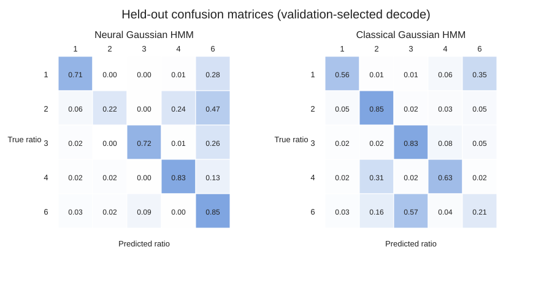
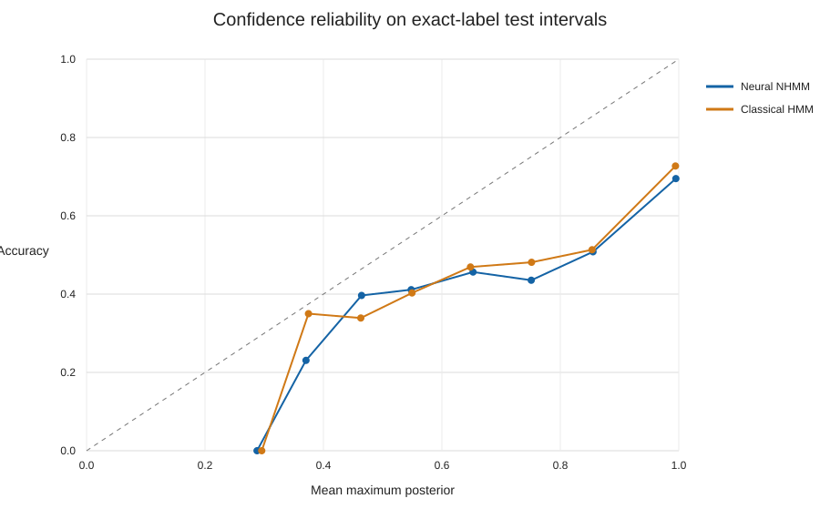
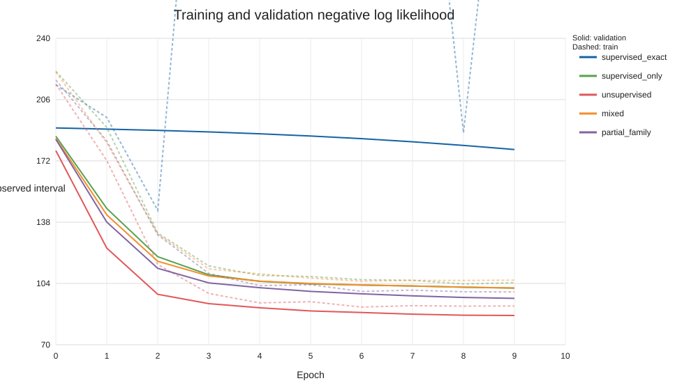

# Generative Neural HMM for subdivision inference

## Summary

This standalone experiment replaced the classical mel50 Gaussian observation likelihood with a small neural parameter generator and kept the five-state HMM, ground-truth beat intervals, fixed subdivision grid, normalized transition matrix, and exact inference. It does **not** use a classifier or CRF as an emission score.

The best Neural HMM reached **0.650 raw balanced accuracy** and **0.664 with a validation-selected decoder**, compared with the official classical score of **0.615**. The matched classical reproduction with uniform initial state and the same `p_stay=0.99`, emission temperature `0.5` decoder scored **0.617**. This is a promising point estimate, but a paired work bootstrap for Neural HMM minus matched classical gave **+0.047**, 95% interval **[−0.061, +0.117]**; the test set therefore does not establish a reliable gain across works. The improvement also comes with a substantial trade: the Neural HMM misses many 2× intervals, while improving 3×/6× and 4×/6× recall.

Unsupervised training obtained a much lower held-out marginal NLL than the classical model, but only **0.424 balanced accuracy** and **0.725 family AUC**. Lower observation NLL alone did not make its latent states musically meaningful. Adding the small unlabeled-only subset to supervised training did not improve subdivision accuracy. This model is not ready to replace the classical system or to be integrated into joint beat/downbeat/subdivision inference.

## Model and objective

The MLP takes a learned state embedding, a fixed beat-relative template derived from candidate subdivision positions, and train-split-standardized log beat duration. The template retains the original fixed ratio grid; its positions are not learned independently. The network outputs a 48-dimensional mean and diagonal-plus-low-rank covariance. A softplus variance floor keeps the diagonal positive. The observation is used only to evaluate the resulting **normalized Gaussian density**, including its normalizer and log determinant; the network never conditions distribution parameters on the observation being scored.

The transition matrix is fixed and normalized, with diagonal probability `p_stay`; the initial state is uniform. Exact log-space forward recursion computes marginal NLL for unlabeled or partially labeled sequences. Exact labels constrain one state, family labels constrain `{2,4}` or `{3,6}`, and unknown labels allow all states. Viterbi and forward-backward use the same emission likelihood. A missing feature row has zero log density, so it contributes no acoustic evidence but retains its HMM state and transitions.

Training used AdamW, learning rate `8e-4`, gradient clipping at 2, at most 10 epochs, and early stopping on constrained validation NLL. The objective is sequence negative log likelihood, averaged over observed intervals, plus a weak covariance regularizer (`1e-4`). The decoder grid over persistence and emission temperature was selected by validation five-class balanced accuracy. The temperature-scaled decoder is a separate post-hoc metric; raw `temperature=1` results are reported as the generative posterior.

## Data and training regimes

The original work-disjoint split was preserved: 116 train, 35 validation, and 18 held-out works. The test comparison covers all **52 performances**, **32,173 intervals**, and **29,339 in-vocabulary labeled intervals**. All test intervals have mel50 features. The source split contains 12,994 train and 2,305 validation intervals without features; complete no-audio sequences were omitted from neural training because they provide no emission learning signal. Missing rows within an included sequence are still handled neutrally by the implementation and unit-tested.

There are only **5 fully exact, audio-bearing training sequences (1,293 intervals)** and 5 matching validation sequences in the strict `supervised_exact` run. `supervised_only` uses 96 audio-bearing training sequences, with exact constraints wherever the five-state labels are available and marginalized states elsewhere. `mixed` uses those same 96 sequences plus 2 unlabeled-only audio sequences (210 intervals), so the labeled examples are matched. `unsupervised` ignores labels in all 98 audio-bearing training sequences. `partial_family` uses the family constraints on all 98. These counts and each run's history are saved beside the checkpoints.

## Held-out results

All rows use the same 18-work / 29,339-label test evaluation. Neural five-class balanced accuracy and accuracy below use the validation-selected decoder. The classical matched row uses uniform initial state, `p_stay=0.99`, and temperature `0.5`, matching the selected Neural HMM decoder. NLL is the untempered marginal observation NLL per observed interval (all 32,173 test intervals), so it remains a generative-model score rather than a classification calibration score.

| Model | BAcc | Accuracy | ECE ↓ | Brier ↓ | Marginal NLL ↓ | Family AUC |
|---|---:|---:|---:|---:|---:|---:|
| Official classical Gaussian HMM | **0.615** | 0.689 | — | — | — | — |
| Classical Gaussian, matched decoder | 0.617 | **0.690** | **0.263** | **0.567** | 142.12 | 0.964 |
| Neural, fully exact subset | **0.664** | 0.673 | 0.296 | 0.616 | 199.83 | 0.931 |
| Neural, supervised only | 0.467 | 0.474 | 0.474 | 0.988 | 96.34 | 0.863 |
| Neural, mixed labeled + unlabeled | 0.459 | 0.456 | 0.493 | 1.019 | 95.87 | 0.841 |
| Neural, unsupervised | 0.424 | 0.429 | 0.516 | 1.067 | **88.63** | 0.725 |
| Neural, partial family labels | 0.442 | 0.436 | 0.478 | 1.016 | 94.58 | 0.800 |
| Neural, diagonal covariance ablation | 0.470 | 0.490 | 0.467 | 0.960 | 99.44 | 0.906 |
| Neural, hidden size 16 | 0.458 | 0.467 | 0.467 | 0.989 | 97.97 | 0.825 |
| Neural, train with `p_stay=0.95` | 0.467 | 0.474 | 0.474 | 0.989 | 96.00 | 0.863 |

ECE and Brier compare maximum posterior confidence on exact-label intervals. Lower is better. The Neural exact model has a better balanced-accuracy point estimate, but **worse calibration**, lower overall accuracy, and worse marginal NLL than the matched classical decoder. Its per-work bootstrap BAcc interval is `[0.449, 0.784]`; the paired interval against matched classical includes zero. The held-out exact-model confusion matrix and per-work metrics are in `results/`.

## Subdivision errors and weak evidence

The Neural exact model's class recalls were `1× .708`, `2× .222`, `3× .715`, `4× .825`, and `6× .851`. Matched classical recalls were `1× .564`, `2× .851`, `3× .833`, `4× .631`, and `6× .205`. Thus:

- On the nested **2×/4×** pair, pairwise balanced accuracy fell from **.699 classical** to **.523 Neural**. Neural recall was .222 for 2× and .825 for 4×; it predicted 4× for 1,384 true 2× intervals.
- On the nested **3×/6×** pair, pairwise balanced accuracy rose from **.511 classical** to **.783 Neural**. Neural recall was .715 for 3× and .851 for 6×, versus .803 and .205 classically.

The score reference flags 3,360 exact-label intervals as partial beats and 485 as ambiguous. On partial beats, Neural balanced accuracy was .556 versus .460 classical. On the ambiguous subset it was .656 versus .539, but that subset is small. These are reference flags, not a direct measure of all mixed duplet/triplet measures; this run did not have a separate measure-level mixed-rhythm annotation.

To examine weak evidence, test intervals were divided into quartiles of each model's single-interval top-two emission log-density margin. In the weakest quartile, balanced accuracy was .604 Neural versus .574 classical. In the strongest Neural-margin quartile, however, Neural balanced accuracy fell to .447 while accuracy was .745, indicating overconfident majority-state errors. Classical top-margin errors also remained common. All test audio features were present, so a held-out missing-feature subgroup could not be measured.

## Unsupervised learning, mixed data, and covariance

The unsupervised model improved marginal NLL to 88.63 from the classical 142.12, but its exact-label BAcc was .424 and family AUC was .725. Its predicted state usage was distributed across classes rather than collapsed to one label, but its state-to-ratio alignment was weak. Its mean diagonal variance was 4.52 and low-rank factor RMS 1.13, consistent with a broad observation model that can fit audio density without recovering the desired score labels. It is direct evidence that generative NLL is not a proxy for subdivision quality.

Mixed training added 210 unlabeled-only intervals to the same supervised sequence set. Test BAcc changed from .467 supervised-only to .459 mixed, while NLL changed only from 96.34 to 95.87. This experiment shows no accuracy benefit from the available unlabeled-only data; the added subset is small. Partial-family supervision also remained below the classical accuracy baseline.

The exact-subset rank-2 model's mean diagonal variance was 1.03 and its factor RMS was only .012, so it effectively learned a diagonal covariance. The explicit diagonal ablation scored .470 BAcc, far below the exact-subset result but close to the other supervised runs. Other trained models inflated mean variances to around 4–5. The low-rank parameterization was numerically stable but did not demonstrate a consistent accuracy or calibration benefit. Changing training persistence from .99 to .95 or hidden size from 48 to 16 did not materially alter the broader supervised result.

## Answers and limits

1. **Does the NHMM beat .615?** The fully exact small-data run does on this test point estimate, both raw (.650) and validation-decoded (.664). The paired work bootstrap against the matched calibrated classical model is +.047 with 95% interval `[−.061, .117]`, so the gain is not established across works. Other supervised/mixed/partial models do not beat .615.
2. **Nested ratios?** It improves 3×/6× and substantially harms 2×/4×, especially 2× recall.
3. **Calibration?** No. ECE and Brier are worse than the matched classical decoder; the highest-margin quartile shows overconfident errors.
4. **Unsupervised states?** No convincing musical alignment. NLL is best, while BAcc and family AUC are poor.
5. **Does unlabeled audio help?** Not in this small mixed run; the extra audio subset is only 210 intervals and test accuracy decreases slightly.
6. **Collapse/overfit/covariance?** There is no one-state prediction collapse, but broad covariance in unsupervised/partial-label models and the high-margin error pattern show that likelihood fit can bypass useful state discrimination. The exact-subset run has only five training and five validation sequences, so its gain may be subset-sensitive.
7. **Ready for joint beat/downbeat/subdivision inference?** No. This controlled test assumes ground-truth beat times, the exact-supervision gain is uncertain, 2×/4× discrimination degrades, and calibration/NLL are worse. More fully labeled works, better coverage of 2×/4×, and a held-out-work-validated emission/calibration strategy are needed first.

## Artifacts

- `model.py`: normalized Gaussian and exact HMM algorithms.
- `data.py`: frozen classical feature/split adapter with missing-feature masks.
- `train.py`: exact, partial, unlabeled, and mixed NLL objectives.
- `evaluate.py`: matched baseline, raw/calibrated metrics, work bootstrap, and test predictions.
- `tests/test_model.py`: density, covariance, forward/backward, constrained inference, gradients, missingness, and synthetic recovery tests.
- `results/*_training.json`, `results/checkpoints/*.pt`: run histories and model checkpoints.
- `results/*_evaluation.json`, `results/matched_metrics.csv`, `results/*_predictions.csv`: test results and predictions. The full test-sequence output for the best Neural model is `results/supervised_exact_all_test_predictions.csv`.
- `results/per_work_metrics.csv`, `results/paired_bootstrap.json`, `results/local_evidence_metrics.csv`, `results/score_ambiguity_metrics.csv`: work and subgroup analyses.
