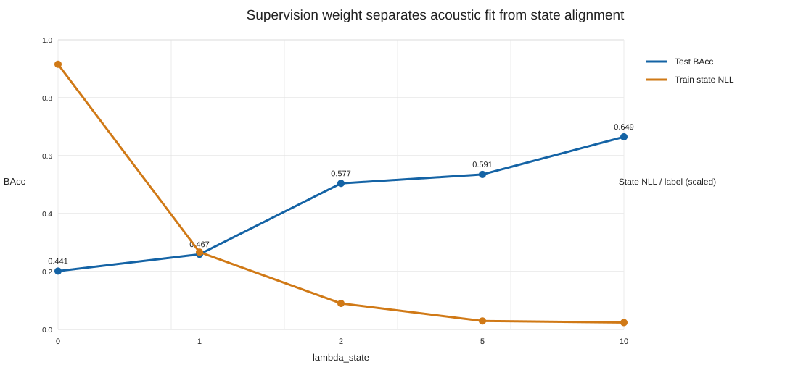
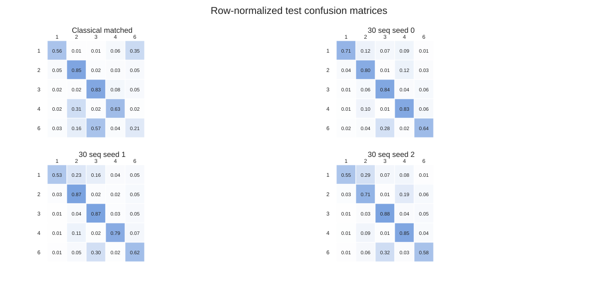
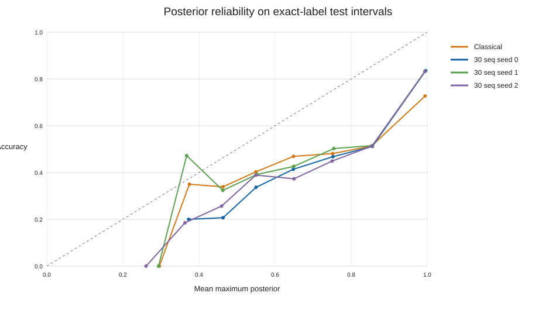

# Diagnosing the generative Neural Subdivision HMM

## Executive result

The original five-sequence result was not evidence that less data is better. The filter selected a narrow, unusually high-confidence sample (Bach and Schubert, mostly 4×, and a much narrower tempo range). The 96-sequence objective also placed much more numerical weight on the 48-dimensional acoustic density than on state identification. At the broad-supervised checkpoint, acoustic NLL was 94.66 nats per beat while posterior state NLL contributed only 6.77 nats per beat. Those two losses had comparable gradient norms but a negative cosine, so improving acoustic fit could directly oppose label alignment.

Separating the exact posterior-supervision term and sweeping its weight corrected much of the failure without changing the normalized emission distribution. On the same 96-sequence set, the flexible Gaussian's three λ=10 seeds scored **0.642–0.652 raw BAcc** (mean .647) and **0.648–0.652 validation-decoded BAcc** (mean **.650**), versus .467 for the original broad supervised checkpoint. The effect is consistent across initialization seeds. Its paired work-bootstrap intervals against the matched classical HMM still include zero, so this is not an established work-level gain.

A fixed 30-sequence subset, always containing the same five fully exact sequences, performed better: three seeds scored **.712, .737, .762** after validation decoder selection (mean **.737**, SD .025). It also improved both nested pairs in point estimates. But its paired work intervals still include zero, the test split has already been examined, and the 30-sequence subset was selected once. Treat that result as a strong exploratory signal, not a publication claim.

The structured zero-mean Gaussian was verified against the classical likelihood and starts at the fitted classical solution. Its state/tempo-conditioned version had an unstable three-seed result: calibrated BAcc .656, .604, and .593 (mean .618). It is therefore not yet a reliable replacement for the flexible emission, although its family AUC was high. More work is needed on the Gaussian parameterization and on 6× recall.

## A. Supervision and sample audit

The new audit rebuilds the frozen original training split and replays `train.choose_sequences()`; it does not use validation or test labels. Complete audio-missing sequences are omitted because they have no acoustic learning signal. There are no missing feature rows inside the selected training sequences.

| Regime | Sequences | Intervals / audio observed | Exact singleton constraints | Two-state family constraints | Unconstrained | High-confidence exact labels |
|---|---:|---:|---:|---:|---:|---:|
| Fully exact (`exact`) | 5 | 1,293 / 1,293 | 1,293 | 0 | 0 | 1,279 / 1,293 |
| Supervised (`supervised_only`) | 96 | 41,792 / 41,792 | 35,316 | 0 | 6,476 | 17,150 / 35,316 |
| Mixed | 98 | 42,002 / 42,002 | 35,316 | 0 in exact mode | 6,686 | 17,150 / 35,316 |
| Partial family | 98 | 42,002 / 42,002 | 5,214 | 33,889 | 2,899 | 17,150 exact labels |
| Unsupervised | 98 | 42,002 / 42,002 | 0 | 0 | 42,002 | ignored |

For broad exact supervision, the 6,476 unrestricted labels are 1,186 label-0 unknowns, 3,612 labels 8/12 that could have supplied family constraints, and 1,678 other out-of-vocabulary labels 16/24. The mixed run adds only **2 audio-bearing sequences and 210 intervals**, none with an in-vocabulary exact label. Partial-family supervision constrains labels 8/12 to `{2,4}` / `{3,6}`; its 33,889 two-state rows also include exact binary and ternary labels represented as family constraints.

The strict five sequences span **five works from two composers** (four Bach works and one Schubert work). The broad 96 sequences span 96 works and 11 composers. The strict exact-label counts are `{1:90, 2:174, 3:192, 4:756, 6:81}`; 4× is 58.5% of that subset. Broad exact-label counts are `{1:5,214, 2:8,738, 3:5,447, 4:10,761, 6:5,156}`; 4× is 30.5% of exact labels. The strict subset is 98.9% high-confidence; only 48.6% of broad exact labels are high-confidence. Its raw beat-duration SD is .197 s versus .405 s broad. Mean per-interval mel50 RMS and mean absolute value are close (2.118 vs 2.164; 1.245 vs 1.254), so gross feature scale is not the main sample difference.

`high_confidence` is set by the score-label builder when the performance/score alignment is good and the measure contains repeated diagnostic attacks (or repeated beat attacks for label 1). The original training mask does not use it: all 18,166 low-confidence labels in the broad set are hard singleton constraints. However, simply unmasking low-confidence labels did not solve the problem: broad λ=10 with high-confidence-only constraints scored .575 calibrated BAcc, below .649 with all exact labels constrained. Label confidence is a real confound, but not the sole cause.

See [the supervision audit note](results/README.md), [full regime JSON](results/supervision_audit.json), [per-work audit](results/per_work_supervision.csv), and [per-composer audit](results/per_composer_supervision.csv).

## B. Exact decomposition of the original objective

For a sequence with allowed-state event `C`, the diagnostic computes two exact forward likelihoods from the same normalized Gaussian HMM:

```text
acoustic_nll = -log p(O | B)
joint_nll    = -log p(O, C | B)
state_nll    = joint_nll - acoustic_nll = -log p(C | O, B)
```

The old trainer minimizes summed constrained joint NLL divided by observed intervals. The new objective reports state NLL per informative constrained interval, then multiplies it by `n_informative / n_observed`. This makes **λ=1 exactly equal** to the original joint objective, while λ>1 increases only the posterior-state contribution. For fully unknown sequences the posterior-state term is exactly zero. This is an auxiliary objective on the same generative model; emissions remain normalized and no classifier/CRF likelihood is introduced.

At the saved original checkpoints:

| Checkpoint / training regime | Acoustic NLL / observed interval | State NLL / observed interval | State NLL / informative interval | Joint NLL / observed interval |
|---|---:|---:|---:|---:|
| Strict exact, 5 sequences | 177.84 | 0.47 | 0.47 | 178.31 |
| Broad supervised, 96 sequences | 94.66 | 6.77 | 8.01 | 101.43 |
| Mixed, 98 sequences | 94.45 | 7.28 | 8.66 | 101.73 |
| Unsupervised, 98 sequences | 86.23 | 0.00 | — | 86.23 |

At the broad supervised checkpoint, the acoustic and posterior-state gradient norms (both normalized per observed interval) were 225.5 and 212.1, with cosine **−0.42**. On the strict exact checkpoint they were 115.2 and 5.8, with cosine −0.65. Thus the broad state term was not absent, but under λ=1 its contribution was small relative to acoustic NLL and its gradients competed with the acoustic objective. The broad model lowered acoustic NLL while leaving a much larger posterior probability penalty on its observed states than the exact-subset model.

Six objective tests verify decomposition, λ=1 identity across sequences with different constraint densities, zero state loss for unknown masks, finite nonzero posterior gradients, and missing-audio masking that preserves temporal transitions.

## C. Posterior-supervision weight sweep

All flexible-emission runs below use the same 96 supervised sequences, seed 0, architecture, optimizer, and split. Model checkpoints are selected by the corresponding weighted validation objective; temperature and transition persistence are separately selected on validation BAcc. Test labels select neither. Marginal NLL is raw, untempered `-log p(O)` on the same 32,173 test observations; BAcc covers the same 29,339 exact-label test intervals.

| λ state | Train acoustic NLL / interval | Train state NLL / constraint | Train joint NLL / interval | Test marginal NLL | Raw BAcc | Validation-decoded BAcc |
|---:|---:|---:|---:|---:|---:|---:|
| 0 | 86.31 | 27.47 | 109.53 | 88.74 | .414 | .441 |
| 1 | 94.66 | 8.01 | 101.43 | 96.34 | .477 | .467 |
| 2 | 99.76 | 2.70 | 102.04 | 100.68 | .575 | .577 |
| 5 | 104.92 | .88 | 105.67 | 105.73 | .595 | .591 |
| 10 | 115.70 | .72 | 116.30 | 120.20 | .647 | **.649** |

The sweep answers the main objective question directly: marginal acoustic likelihood alone continues to favor a poor state assignment; increasing the state term improves label inference while worsening the pure acoustic NLL. λ=10 broad flexible models repeat well across three optimization seeds: raw BAcc `.647, .642, .652`; validation-decoded BAcc `.649, .648, .652` (mean .650, SD .002). Their average 6× recall is .260, still only slightly above the classical .205. Their average ECE/Brier are .206/.468 versus .263/.567 for matched classical; calibration improves, though the five-class gain remains uncertain.

The old state names are not assumed meaningful in the unsupervised model. A 120-permutation mapping and decoder grid were selected on validation only. This raised unsupervised test BAcc from .424 to .468, but test accuracy fell from .429 to .389 and ECE worsened to .555; the result remains below the classical baseline and shows weak latent-state identification. The validation-selected mapping was `1→1, 2→3, 3→6, 4→4, 6→2`.



## D. Controlled sequence additions

Using the same λ=10 architecture and training recipe, each smaller set retains the same five exact sequences and adds a deterministic, recorded selection of partially labeled sequences. Sequence identity is fixed across optimization seeds. The results are:

| Training sequences | Test BAcc across seeds | Mean accuracy | Mean family AUC | Mean 6× recall |
|---:|---|---:|---:|---:|
| 5 exact | .639 (one run) | .675 | .958 | .238 |
| 10 | .677 (one run) | .707 | .953 | .653 |
| 30 | .762, .737, .712 | .789 | .968 | .613 |
| 96 | .649, .648, .652 | .725 | .951 | .260 |

The 30-sequence set has 15,552 intervals, 30 works and seven composers; its exact-label class counts are `{1:1763, 2:3523, 3:2659, 4:3346, 6:2442}`. It is not a cleaner subset by the audit's confidence flag: only 46.3% of its exact labels are high-confidence, close to the broad 48.6%. It is more class-balanced than the strict five-sequence subset and has substantially more 6× labels. Performance drops when expanding this particular subset to all 96. That points to work/label heterogeneity and the sampling/filtering interaction, not merely a need for more intervals. Since only one deterministic 30-sequence selection was tested, the result could be subset-specific.

The n=30 models improved the 2×/4× pairwise BAcc to .808 (three-seed mean) from .741 classical, and the 3×/6× pair to .737 from .519. Mean class recalls were 1× .594, 2× .795, 3× .862, 4× .821, 6× .613 versus classical `.564, .851, .833, .631, .205`. The six-state recall increase is accompanied by 3× recall holding or improving; it is not a simple 6×-for-3× swap. The model predicts 6× more often than the score frequency, however, and its acoustic NLL is about 179—worse than classical 142.

Paired work bootstrap deltas against the matched classical model are positive for all three 30-sequence seeds (+.145, +.120, +.095), but all 95% intervals include zero: `[−.153,.219]`, `[−.185,.189]`, `[−.197,.172]`. Broad λ=10 deltas are +.032, +.032, +.035, also with intervals including zero. This test set is too small and has been examined too often to support a definitive claim.





## E. Classical-structured neural Gaussian

The source classical emission is zero-mean, not a positive onset-template mean:

\[
 y\mid r \sim \mathcal N(0,\ s^2I+\tau_\mu^2\mathbf1\mathbf1^\top+\tau_a^2h_rh_r^\top).
\]

The original mel50 fit uses `s²=1`, `τμ²=1`, `τa²=16`, and width `.03`; these values are recovered from `run_experiment.py`'s fit grid/results. The new structured emission predicts positive shared scales for exactly this covariance, optionally conditioned on the fixed ratio template and exogenous tempo. Its zero-correction initialization reproduces the source Gaussian log density to max absolute error `8.2e−5` on a sample and yields identical Viterbi paths to the direct classical HMM before training. The initialization's raw BAcc is .606 and its validation-decoded BAcc is .615, matching the classical baseline.

| Structured model, λ=10 | Raw BAcc, seeds | Calibrated BAcc, seeds | Mean family AUC | Mean ECE / Brier |
|---|---|---|---:|---:|
| Shared global scales, no ratio/tempo conditioner | .611 | .586 | .984 | .— |
| Ratio + tempo conditioned, classical initialized | .689, .623, .604 | .656, .604, .593 | .980 | .223 / .471 |

The conditioner improves the mean over the trained shared-only model but has a broad seed spread. It raises family AUC, yet often predicts 6× too rarely: the conditioned seeds' 6× recall is `.104, .113, .136`, below the classical .205. The family improvement therefore does not establish reliable five-class subdivision. These structured results do not support replacing the flexible model yet.

The first structured training attempt produced an infinite regularizer, which led to NaN gradients and then a Cholesky error. This was a tuple-contract bug: the generic flexible-emission regularizer interpreted structured `(diagonal variance, low-rank factors, scales)` as `(mean, variance, factors)` and evaluated `log(0)` on a zero template factor. It was corrected by disabling that incompatible regularizer for this first structured comparison; the fixed classical initialization and exact normalized density are unchanged. The code also retains a positive scale floor and symmetrizes the Woodbury matrix. A full 48-feature optimizer stability test now passes.

## F. Questions and conclusions

**Q1. Why did five exact sequences beat the original 96?** The five were selected for complete in-vocabulary annotation and audio availability, not sampled representatively. They are nearly all high-confidence, concentrated in two composers, strongly 4×-weighted, and slower/more tempo-homogeneous. The broad set hard-constrains 18,166 low-confidence labels and includes more heterogeneous works. Separately, the original joint objective made acoustic NLL about 14× larger than state NLL per interval at the fitted checkpoint; the gradients competed. The λ sweep's repeatable improvement demonstrates that objective scaling is a major cause. Filtering to only high-confidence labels does not by itself recover the result, and one 30-sequence selection shows that sample composition still matters.

**Q2. Can generative likelihoods yield musically meaningful states?** Yes in principle and in these controlled runs: exact Gaussian likelihood plus a posterior constraint term derived from the same HMM improves meaningful state assignment while preserving a normalized generative density. Unsupervised likelihood alone does not.

**Q3. Does stronger posterior supervision help?** Yes. Broad flexible λ=10 improves test BAcc from .467 to a three-seed mean of .650 and lowers ECE/Brier, at the cost of worse marginal acoustic NLL. λ=10 on the five exact sequences does not beat the original λ=1 result, whose posterior state loss was already small.

**Q4. Does classical covariance structure improve reliability?** It provides an excellent exact initialization. Training a ratio/tempo conditioner raises family AUC, but three-seed calibrated BAcc averages only .618, and 6× recall worsens. The unconditioned shared-scales version is weaker. The structured branch is not yet a reliable win.

**Q5. Can additional labeled or unlabeled sequences help?** The selected 30-sequence labeled subset improves point estimates over five and 96 sequences, with repeatability across network seeds; more sequences are not monotonically better. The original mixed run adds only 210 unlabeled intervals and is negative. No λ=10 large-unlabeled experiment was run, so this does not establish whether substantially more unlabeled audio can help.

**Q6. Is there a reproducible gain over .617, especially on nested subdivisions?** The λ=10 broad result is reproducible across seeds but averages .650 and has paired work intervals spanning zero. The 30-sequence subset has larger, consistent seed-wise test gains and better nested-pair recall, but the paired work intervals still span zero and the data subset was chosen once. Do not claim a confirmed benchmark improvement. An untouched work-disjoint test is required before publication or integration. Joint beat/downbeat/subdivision inference is not ready.

## Reproduction and artifacts

From the repository root:

```sh
python -m unittest discover -s neural_subdivision_hmm/diagnostics/tests -t . -v
python -m neural_subdivision_hmm.diagnostics.audit_supervision
python -m neural_subdivision_hmm.diagnostics.weighted_train --name broad_l10_s0 --mode supervised_only --lambda-state 10 --seed 0
python -m neural_subdivision_hmm.diagnostics.structured_train --name structured_broad_l10_s0 --mode supervised_only --lambda-state 10 --seed 0 --condition-on-ratio --condition-on-duration
```

The sweep and selected run metadata, checkpoints, predictions, audit tables, decompositions, permutation analysis, and SVG figures are under `diagnostics/results/` or beside this report. The parent `neural_subdivision_hmm/` code, checkpoints, and report remain unchanged.
